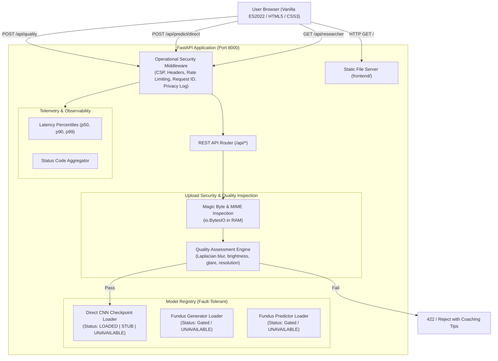

# System Architecture & Technical Specifications

## 1. High-Level Architecture Diagram

## 2. Component Design Principles

### Frontend Architecture
- **Vanilla ES2022**: Zero external JavaScript frameworks (no React, Vue, or Angular) and zero frontend npm packages. No transpilation or build step.
- **XSS Protection**: Strictly avoids `innerHTML` for dynamic content rendering; uses `document.createElement`, `textContent`, and safe DOM utilities in `js/ui.js`.
- **Accessibility (WCAG AA)**: Skip links (`#main-content`), ARIA live regions (`aria-live="polite"`), high-contrast CSS variable tokens, focus rings (`:focus-visible`), and media query support for `prefers-reduced-motion` and `prefers-color-scheme`.

### Backend Architecture
- **Fault-Tolerant Model Registry**: Missing model weight files never crash the process. The loader evaluates checkpoints on startup and reports `LOADED`, `STUB`, or `UNAVAILABLE`.
- **Quality Gating**: Evaluates 5 photographic parameters (resolution, blur via Laplacian variance, brightness, glare via overexposed pixel ratio, and ocular landmark presence). Any failing check immediately blocks prediction and returns actionable coaching tips.
- **Strict In-Memory Processing**: Uploaded binary data is decoded strictly in RAM via `io.BytesIO` and Pillow. Zero bytes or image artifacts are written to disk.
